# GODSPEED

Simulator dashboard sepeda motor + navigasi untuk **LVGL 9**, dengan satu sumber UI yang
sama untuk **Windows (SDL2)** dan **ESP32-S3 N16R8 + ILI9341 320x240**.

Fokus utama: animasi halus 60 FPS, angka kecepatan besar yang bergulir, gauge putih-merah
dengan zona merah, panel RPM/throttle bergaya racing, peta vektor dengan rute dan instruksi
belok, drag strip dengan countdown/split/PB, GPS clock, serta tiga tema: race (default),
siang, dan malam. Animasi startup GODSPEED dipakai bersama oleh simulator dan firmware.

| Race - speedometer | Race - navigasi |
|---|---|
| 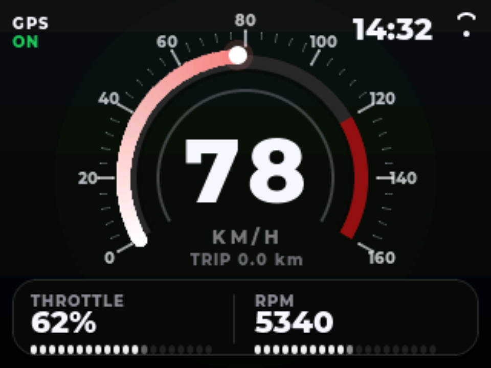 | 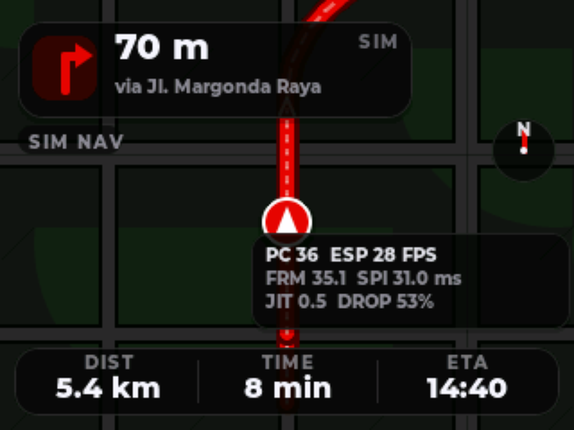 |

| Siang - speedometer | Malam - speedometer |
|---|---|
| 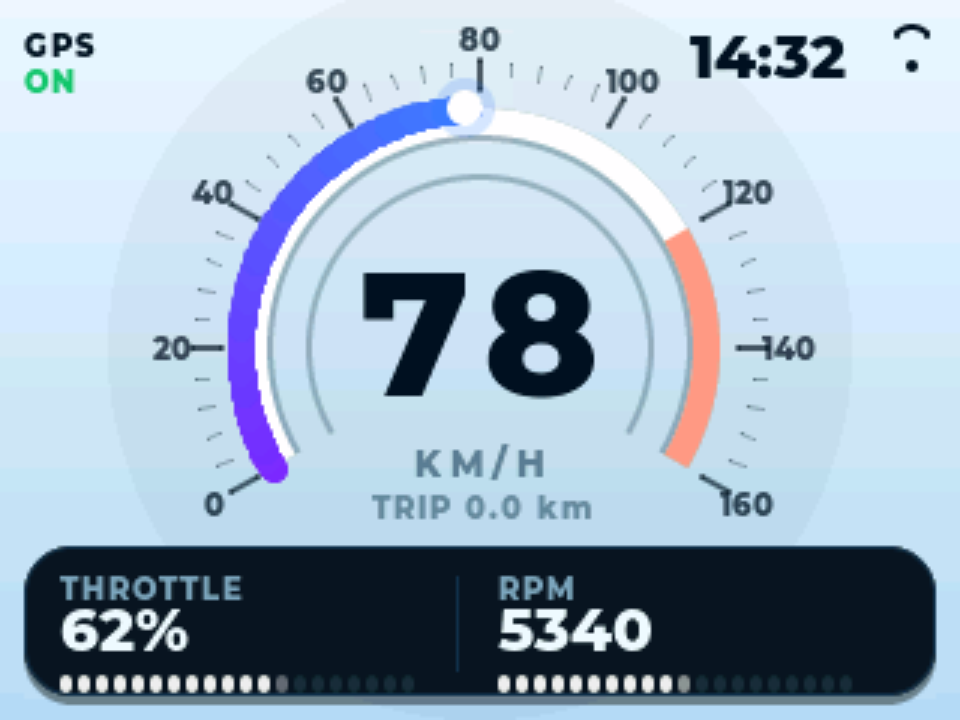 | 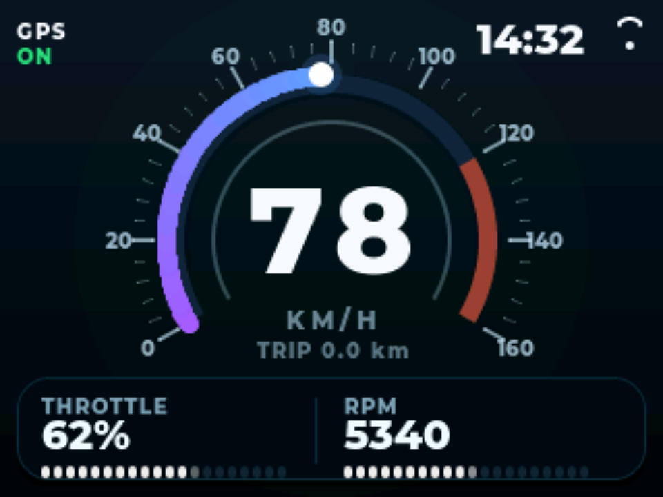 |

| Siang - navigasi | Malam - navigasi |
|---|---|
| 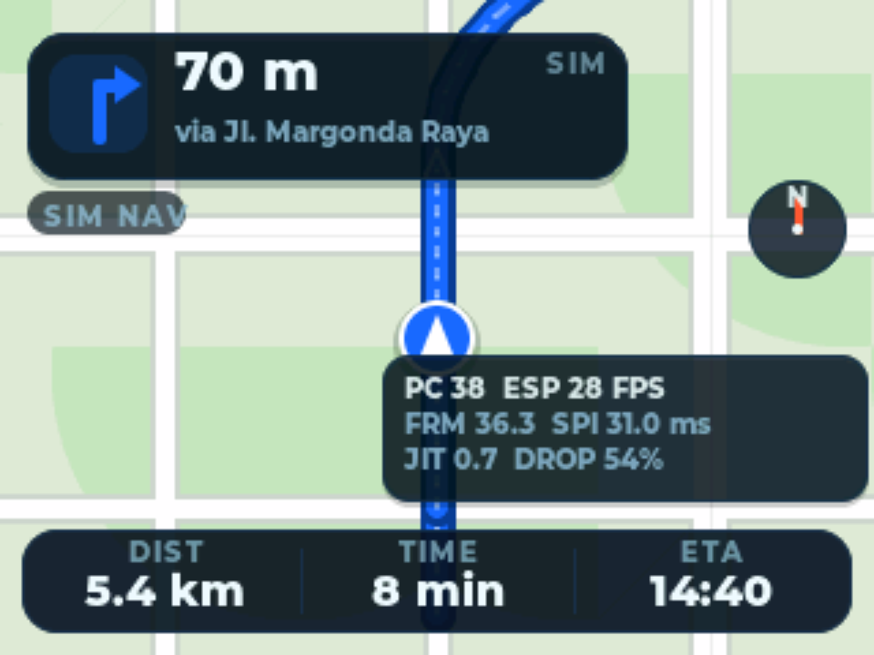 | 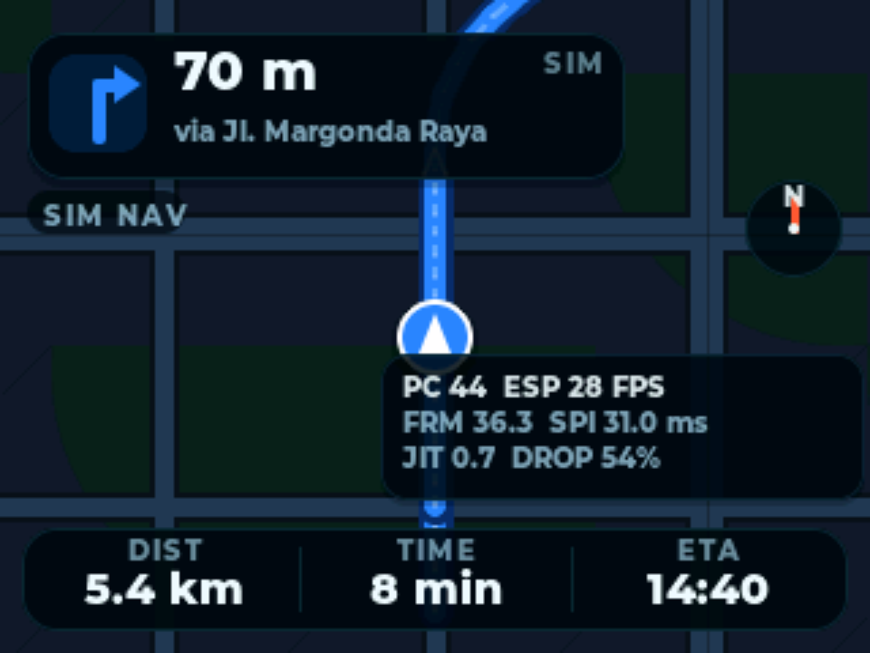 |

| Drag countdown | Drag running |
|---|---|
| 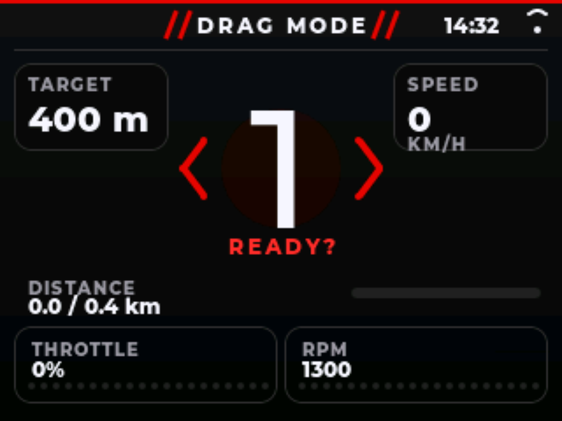 | 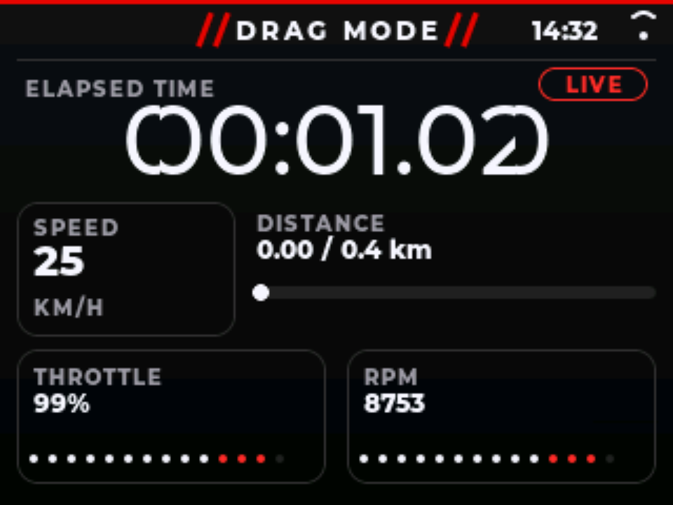 |

| Drag finish | GPS clock |
|---|---|
| 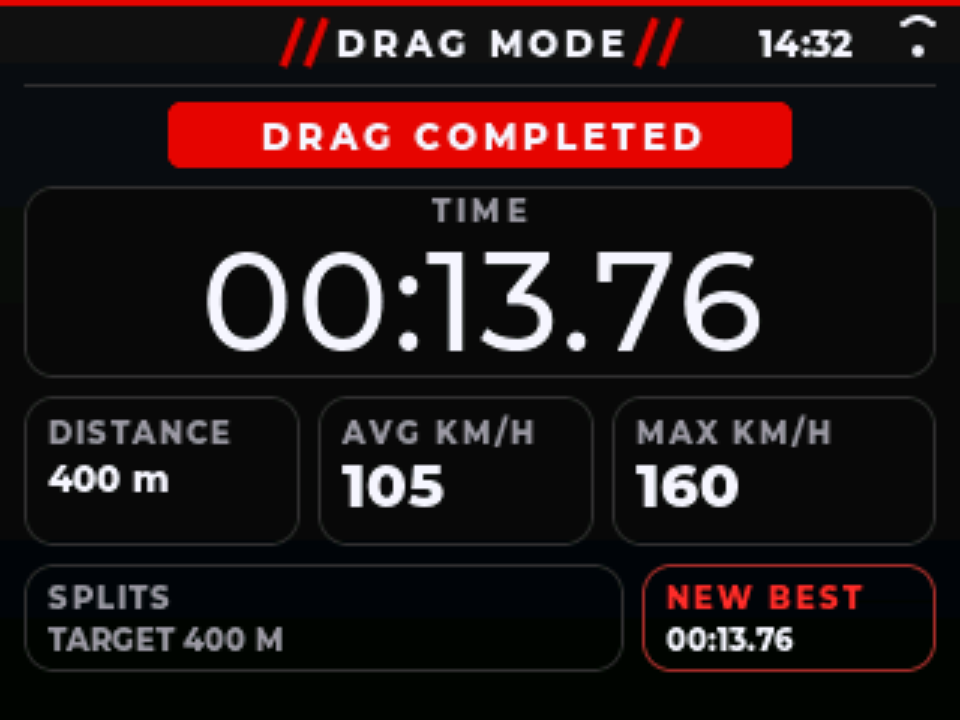 | 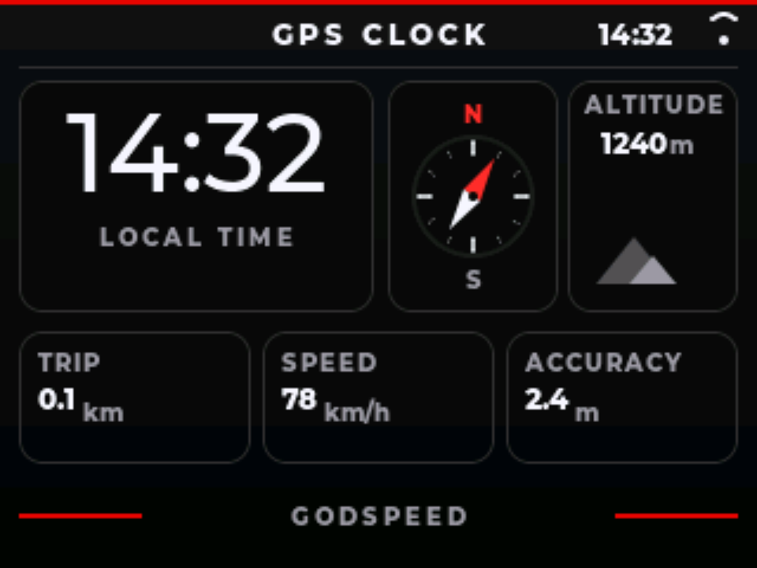 |

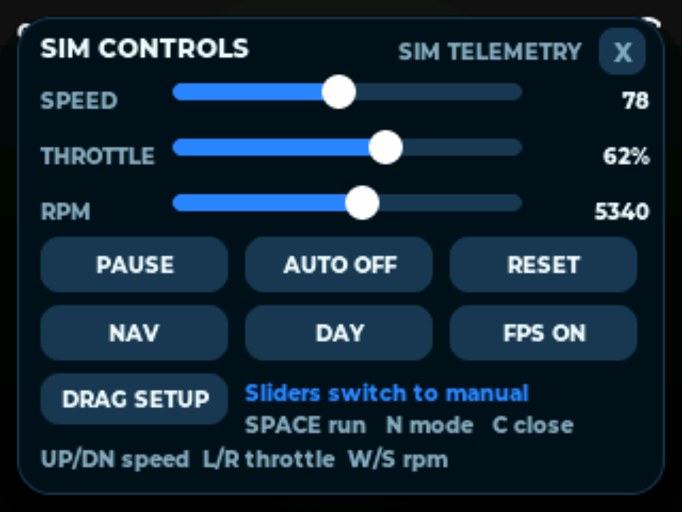

| Animasi startup |
|---|
| 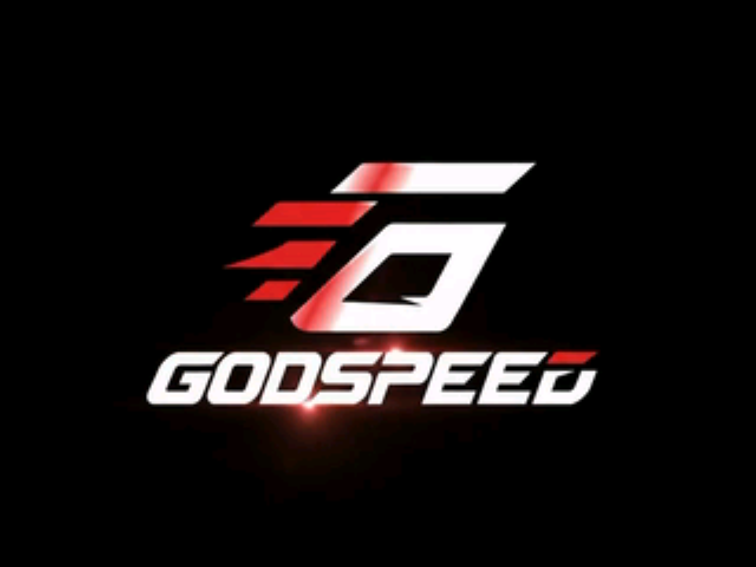 |

## Fitur

- Speedometer full-custom: gauge 0-160 km/h dengan zona merah 120-160, cincin dalam,
  label GPS ON hijau, angka 3 digit dengan transisi geser/crossfade per digit, trip,
  serta bar throttle dan RPM putih-merah.
- Navigasi full-custom: peta vektor berputar mengikuti heading, rute dengan chevron,
  puck kendaraan, kartu instruksi belok, kompas, DIST/TIME/ETA.
- Drag strip: countdown 3-2-1-GO, elapsed time, kecepatan, progress target, split per
  interval, PB/riwayat, dan uji akselerasi 0-60/0-100 km/h.
- GPS clock: jam lokal, kompas/heading, altitude, kecepatan, trip, dan akurasi GPS.
- Tema race, siang, dan malam dengan transisi halus (bukan ganti warna mendadak).
- Telemetri simulasi: siklus skenario kota 124 detik, gearbox 6 percepatan, atau mode
  manual lewat panel kontrol.
- Overlay kontrol (slider + tombol) di `lv_layer_top()`, bisa dipakai dengan mouse.
- Redraw selektif: hanya area yang berubah (gauge, digit, kartu statistik, jam) yang
  diinvalidasi; peta navigasi tetap full-frame tetapi dibatasi 30 FPS.
- FPS PC, FPS ESP32 model, frame time, SPI time, jitter, dan drop ditampilkan terpisah
  di layar navigasi (bisa disembunyikan).
- Screenshot dan benchmark frame time + model ESP32 dari command line.
- Animasi startup GODSPEED 320x240 RGB565: 56 frame unik, 92 tick @30 FPS, delta+RLE,
  dengan logo `LOGO.png` sebagai fallback jika aset animasi gagal dibaca.

## Build simulator (Windows)

Prasyarat: CMake >= 3.20 dan Visual Studio 2022 Build Tools (MSVC x64).
LVGL 9.3.0 ada di `third_party/lvgl` sebagai submodule, SDL2 2.30.9 sudah ada di
`third_party/SDL2`. Jika clone dari GitHub, sertakan submodule:

```powershell
git clone --recursive https://github.com/hnftxx/MiniMotoNav.git
```

> URL GitHub masih memakai nama lama; perbarui setelah repositori di-rename menjadi
> GODSPEED.

```powershell
cmake -S . -B build -G "Visual Studio 17 2022" -A x64
cmake --build build --config Release --parallel
ctest --test-dir build -C Release --output-on-failure
.\build\Release\GODSPEED.exe
```

`SDL2.dll` disalin otomatis ke folder executable oleh CMake.

### Argumen

| Argumen | Fungsi |
|---|---|
| `--mode=speedo` / `nav` / `drag` / `gps` | Mulai di speedometer, navigasi, drag strip, atau GPS clock |
| `--drag-target=M` | Target drag dalam meter (default 400) |
| `--drag-split=M` | Interval split dalam meter (default 1000) |
| `--drag-countdown=MS` | Countdown drag dalam milidetik (default 3000) |
| `--theme=race` / `day` / `night` | Mulai dengan tema race (default), siang, atau malam |
| `--controls` | Buka panel kontrol saat start |
| `--scale=N` | Skala jendela 1-6 (default 3 = 960x720) |
| `--novsync` | Jalankan tanpa batas 60 FPS (untuk uji beban) |
| `--no-fps` | Sembunyikan penghitung FPS |
| `--profile=conservative` / `balanced` / `optimistic` / `custom` | Preset model performa ESP32 (default balanced) |
| `--spi=HZ` | Override clock SPI model (default 40 MHz) |
| `--buffer=LINES` | Override tinggi buffer parsial LVGL (default 40 baris) |
| `--cpu=US_PER_PX` | Override biaya CPU model per piksel yang di-flush |
| `--jitter=RATIO` | Override jitter model 0-0.5 |
| `--dma` | Modelkan DMA overlap dengan double buffer (bukan pengukuran hardware) |
| `--bench=N` | Ukur N frame, cetak avg/p95/max frame + render time + model ESP32 |
| `--shot=file.bmp` | Simpan screenshot setelah warm-up |
| `--boot` / `--no-boot` | Paksa tampil / lewati animasi startup |
| `--boot-shot=file.bmp` | Tangkap satu frame startup lalu keluar |
| `--boot-frame=N` | Frame startup yang ditangkap (default 30) |
| `--speed=N` | Kecepatan untuk screenshot (default 78 km/h) |
| `--warmup=N` | Jumlah frame sebelum screenshot (default 150) |
| `--help` | Daftar argumen |

Contoh:

```powershell
.\build\Release\GODSPEED.exe --bench=600 --mode=nav --theme=race
.\build\Release\GODSPEED.exe --shot=shots\race_nav.bmp --warmup=180 --mode=nav --theme=race
.\build\Release\GODSPEED.exe --boot-shot=shots\boot_animation.bmp --boot-frame=30
ffmpeg -y -i shots\race_nav.bmp shots\race_nav.png
ffmpeg -y -i shots\boot_animation.bmp shots\boot_animation.png
```

### Tombol keyboard

| Tombol | Aksi |
|---|---|
| `Esc` | Keluar |
| `Space` | Jalan / pause; di drag: arm, pause, resume, atau run again |
| `N` | Ganti mode: speedometer -> navigasi -> drag -> GPS clock |
| `T` | Ganti tema: race -> siang -> malam -> race |
| `C` | Buka / tutup panel kontrol |
| `F` | Tampilkan / sembunyikan FPS (di navigasi) |
| `R` | Reset simulasi / sesi drag |
| `Up` / `Down` | Naik/turun kecepatan manual (5 km/h) |
| `Left` / `Right` | Turun/naik throttle (5%) |
| `W` / `S` | Naik/turun RPM (250) |

## Hasil pengukuran simulator

Diukur pada build MSVC Release, 320x240, `--bench=600 --novsync --profile=balanced`.
`dirty` adalah rata-rata piksel dan rect yang benar-benar di-flush **per frame yang
digambar**, bukan per frame loop. Frame tanpa invalidasi tidak dihitung.

| Layar | Dirty px / rects | Frame digambar | Render PC avg | p95 render | Model ESP32 40 MHz |
|---|---|---|---|---|---|
| Speedometer | 24.325 / 3,0 | 570/570 | 0,56 ms | 1,02 ms | 11,9 ms / 60 FPS |
| Navigasi | 76.800 / 6,0 | 271/570 | 0,76 ms | 1,97 ms | 35,6 ms / 28 FPS |
| GPS clock | 12.377 / 2,0 | 570/570 | 0,14 ms | 0,36 ms | 6,5 ms / 60 FPS |
| Drag (idle) | 18.231 / 2,0 | 71/570 | 0,03 ms | 0,17 ms | 9,1 ms / 60 FPS |

Navigasi menginvalidasi seluruh peta, tetapi hanya 30 kali per detik. Pada SPI 40 MHz
satu frame penuh 320x240 RGB565 butuh sekitar 30,7 ms hanya untuk transfer, sehingga
model 40 MHz membatasi navigasi ke sekitar 28 FPS. Model profil penuh untuk frame
76.800 px:

| Profil | Frame model | FPS model | SPI | Late |
|---|---|---|---|---|
| Conservative 20 MHz | 67,5 ms | 14,8 | 61,8 ms | 75% |
| Balanced 40 MHz | 35,6 ms | 28,1 | 31,0 ms | 53% |
| Optimistic 80 MHz | 19,6 ms | 51,0 | 15,5 ms | 15% |

Loop interaktif dipacu tetap 60 FPS. Indikator FPS (layar navigasi) menunjukkan FPS PC
dan FPS ESP32 model secara terpisah (`PC ... ESP ... FPS`). Angka model adalah estimasi
deterministik, **bukan** klaim performa ESP32 fisik.

## Animasi startup

Animasi diambil dari `Godspeed Edited.mp4` (848x464, 30 FPS), diskalakan ke 320x240
RGB565, lalu frame identik digabung. Hasil akhir: **56 frame unik / 92 tick / 3,07 detik**.
Setiap frame disimpan sebagai delta terhadap frame sebelumnya; perubahan seragam memakai
RLE, perubahan lain disimpan literal. Format record adalah `u16 skip, u16 run` little-endian,
dengan bit tinggi `run` menandai RLE dan sentinel `0,0` di akhir frame.

| Metrik | Nilai |
|---|---|
| Frame sumber 92 frame | 14.131.200 B |
| Frame unik mentah | 8.601.600 B |
| Full-frame RLE | 1.382.736 B |
| **Delta+RLE (dipakai)** | **1.407.358 B** |
| Delta literal | 1.544.296 B |
| Rata-rata piksel berubah | 10.359 px |
| Rata-rata bbox dirty | 28.203 px |
| Logo fallback 300x110 | 28.030 B PNG / 30.996 B RLE |

Delta+RLE dipilih meski 24.622 B lebih besar dari full-frame RLE karena firmware hanya
mengirim bbox yang berubah. Pada SPI 40 MHz, bbox rata-rata sekitar 56 KB atau ~11 ms;
frame penuh 153.600 B membutuhkan ~30,7 ms. Framebuffer 153.600 B dialokasikan di PSRAM
(fallback ke RAM internal), lalu dikirim per baris dengan `pushColors(..., true)`.

Aset dibangkitkan ulang dengan Node + ffmpeg:

```powershell
node tools\generate_boot_assets.js
```

Generator menulis `src/boot/boot_assets.cpp`, `assets/godspeed_logo_320.png`, dan
`assets/boot_stats.json`. Jangan mengedit `boot_assets.cpp` manual. Jika video/logo berada
di lokasi lain, set `GODSPEED_VIDEO` dan `GODSPEED_LOGO`.

Simulator memutar animasi sebelum loop utama. Screenshot biasa otomatis melewati boot
kecuali `--boot` diberikan; `--bench` selalu melewati boot. Firmware memutar animasi
setelah `app.init()` dan sebelum `ble.begin()`.

## Struktur proyek

```
src/app/          telemetri simulasi, state aplikasi, tipe performa, protokol BLE
src/boot/         aset animasi startup + decoder bersama
src/ui/           speedometer, navigasi, drag, GPS clock, panel kontrol, drawing helpers
src/ui/fonts/     font Montserrat ExtraBold hasil konversi lv_font_conv
src/platform/     entry point ESP32 (TFT_eSPI, NimBLE)
sim/              SDL2 platform + main simulator
tests/            unit test telemetri, drag, perf, command, BLE, boot (CTest)
tools/            generator aset boot (Node + ffmpeg)
assets/           logo startup hasil optimasi + statistik kompresi
include/          User_Setup.h untuk TFT_eSPI
lv_conf.h         konfigurasi LVGL bersama
CMakeLists.txt    build simulator + test
platformio.ini    build firmware ESP32-S3
third_party/      LVGL (submodule) + SDL2 prebuilt
```

## Target ESP32-S3 N16R8

### Perangkat

- ESP32-S3 DevKitC-1 N16R8 (16 MB flash, 8 MB PSRAM)
- ILI9341 2.8" 320x240 SPI
- Kabel jumper, backlight panel ke GPIO7 (atau 3V3)

### Wiring default (`include/User_Setup.h`)

| ILI9341 | ESP32-S3 |
|---|---|
| VCC | 3V3 |
| GND | GND |
| CS | GPIO10 |
| RESET | GPIO8 |
| DC | GPIO9 |
| MOSI / SDI | GPIO11 |
| SCK | GPIO12 |
| MISO / SDO | GPIO13 (opsional) |
| LED / BL | GPIO7 |

Ubah pin di `include/User_Setup.h` jika wiring berbeda. File itu di-*force include*
oleh `platformio.ini`, jadi TFT_eSPI dan firmware memakai definisi yang sama.
Jika panel menampilkan warna terbalik, aktifkan `TFT_INVERSION_ON` di file tersebut.
Landscape diatur oleh `tft.setRotation(1)` di `src/platform/esp32_main.cpp`
(gunakan `3` bila gambar terbalik).

### Build & upload

```powershell
pip install platformio
pio run -e esp32s3
pio run -e esp32s3 -t upload
pio device monitor
```

Gunakan port **USB UART** pada DevKitC-1 (bukan port USB native) untuk upload dan
monitor serial. Jika upload 921600 baud tidak stabil, turunkan `upload_speed` ke
`460800` di `platformio.ini`.

Konfigurasi memakai LVGL 9.3.0 + TFT_eSPI dari registry PlatformIO, buffer parsial
320x40 baris, dan flush manual RGB565 (`pushColors(..., true)`). Firmware mencetak
diagnostik boot (chip, flash, PSRAM, heap, jumlah frame/tick animasi) dan statistik
refresh per detik di serial.

Status build terakhir (PlatformIO, `pio run -e esp32s3`):

| Memori | Terpakai | Kapasitas | Persentase |
|---|---|---|---|
| RAM statis | 70.416 B | 327.680 B | 21,5% |
| Flash (app) | 2.460.467 B | 6.553.600 B | 37,5% |

Angka di atas adalah hasil kompilasi, bukan hasil pengukuran di perangkat. Kenaikan
flash terutama berasal dari data animasi startup (~1,44 MB) dan kode BLE; framebuffer
boot 153.600 B dialokasikan saat runtime di PSRAM.

### Catatan performa hardware

Firmware ini **belum diuji pada perangkat fisik**. Jangan menganggap 60 FPS di ESP32
sudah tercapai sebelum diukur. Setelah flash, buka serial 115200 dan gunakan tombol:

| Tombol | Aksi |
|---|---|
| `n` | Ganti mode: speedometer -> navigasi -> drag -> GPS clock |
| `t` | Ganti tema race -> siang -> malam -> race |
| `f` | Tampilkan / sembunyikan overlay FPS |
| `p` | Pause / jalan |
| `d` | Arm / pause / resume / run again di drag mode |
| `r` | Reset simulasi / sesi drag |
| `?` | Bantuan tombol dan perintah |

Perintah teks diakhiri Enter juga tersedia: `mode nav`, `theme day`, `speed 80`,
`throttle 60`, `rpm 5000`, `target 400`, `split 200`, `countdown 3000`, `drag`,
`dragreset`, `pause`, `auto`, `controls`, `fps`, `reset`. Perintah memakai parser yang
sama dengan simulator.

Firmware mencetak statistik berikut tiap detik:

```text
[stats] fps=... frame=...ms render=...ms spi=...ms dirty=PX/RECTS worst=...ms heap=...
```

FPS dihitung dari siklus refresh LVGL termasuk flush,
bukan dari loop kosong. `spi` adalah rata-rata durasi flush, `dirty` adalah rata-rata
piksel dan rect per refresh. Overlay navigasi menampilkan label `HW` untuk angka yang
diukur firmware, bukan `ESP` yang berarti model simulator. Jika PSRAM N16R8 terdeteksi,
baris boot harus menunjukkan `psram=8MB`; jika `0MB`, konfigurasi OPI belum aktif.

Jika FPS di bawah 60, turunkan `kBufferLines` (mis. 20), naikkan
`LV_DEF_REFR_PERIOD` ke 16, atau kurangi jumlah segmen gradien gauge (96).
Pastikan SPI 40 MHz stabil; turunkan ke 27 MHz bila muncul artefak. Buffer render
berada di RAM internal, jadi PSRAM tidak wajib untuk kode ini.

## Model telemetri

- Mode otomatis: target kecepatan mengikuti siklus 124 detik (34, 78, 48, 96, 62, 122,
  70 km/h) dengan slew target 18 km/h/s dan batas akselerasi -16/+10.5 km/h/s.
- Gearbox 6 percepatan: RPM dihitung dari window kecepatan tiap gear.
- Mode manual: slider kecepatan 0-160, throttle 0-100%, RPM 800-9000.
- Trip meter terintegrasi dari kecepatan; clock mulai 14:32 dan maju 1 menit per
  60 detik simulasi.
- Navigasi memakai loop rute sintetis + grid jalan deterministik; bukan GPS nyata.
- Drag memakai timestamp monotonic, bukan FPS: countdown, elapsed, split, dan finish
  diinterpolasi dari timestamp. Jarak simulasi diintegrasikan dari kecepatan; data GPS
  yang tidak valid membekukan jarak dan menandai hasil sebagai tidak reliabel.
- GPS clock menampilkan jam lokal, heading/kompas, altitude, speed, trip, dan akurasi
  dari telemetri simulasi.

## Keterbatasan

- Belum ada input touch pada target ESP32 (panel kontrol hanya di simulator); layar,
  tema, drag, dan FPS dapat diganti lewat tombol atau perintah serial.
- Panel drag di simulator punya preset target 100 m / 200 m / 400 m / 1 km / 2 km dan
  slider target, countdown, split, serta acceleration test. Nilai ini tidak muncul di
  firmware tanpa input touch; gunakan perintah `target`, `split`, dan `countdown`.
- Belum ada GPS/IMU nyata; semua data disimulasikan.
- Riwayat drag/PB masih in-memory dan hilang saat reboot.
- Timing drag dirancang untuk closed course; GPS ponsel tidak boleh diklaim
  memberikan akurasi milidetik.
- Rute navigasi adalah demo geometris, bukan data peta/OSRM.
- Performa hardware dan animasi startup di panel fisik belum diverifikasi; frame rate
  boot di simulator tidak menjamin timing SPI/PSRAM di ESP32-S3.

## Lisensi komponen pihak ketiga

- LVGL 9.3.0 - MIT
- SDL2 2.30.9 - zlib
- Montserrat (SIL Open Font License 1.1), dikonversi ke font LVGL.
